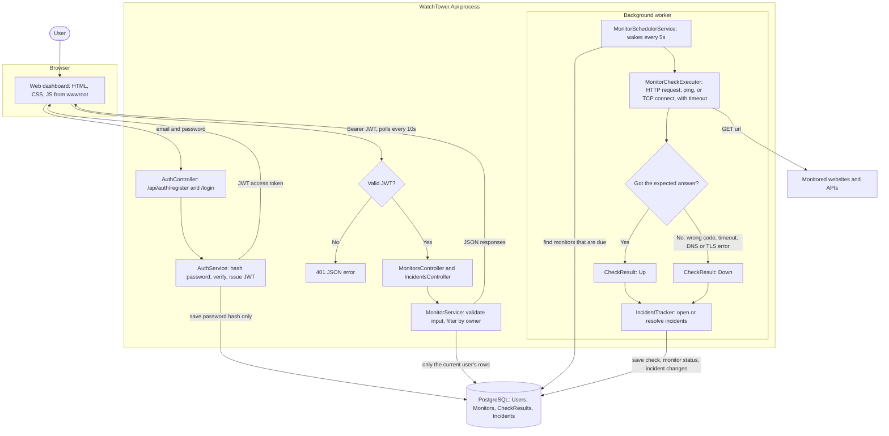
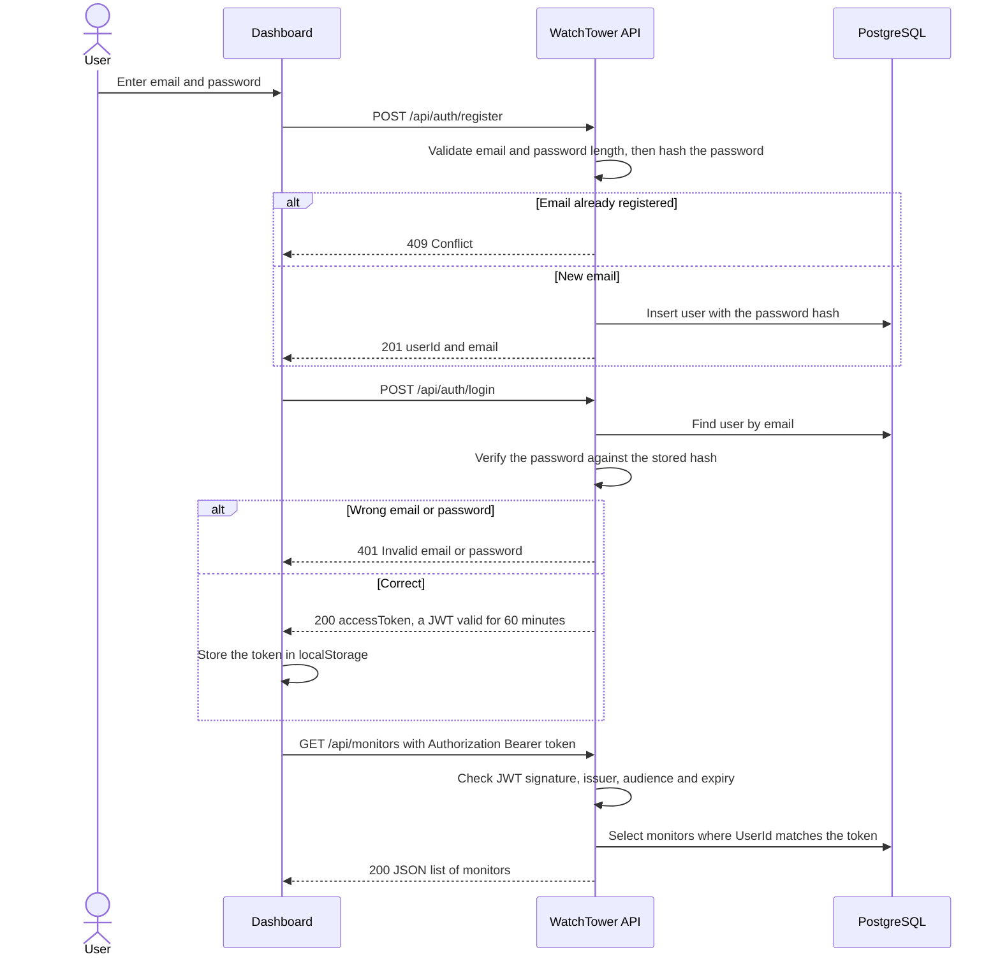
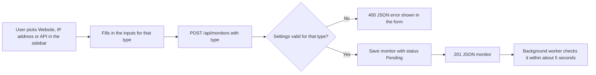
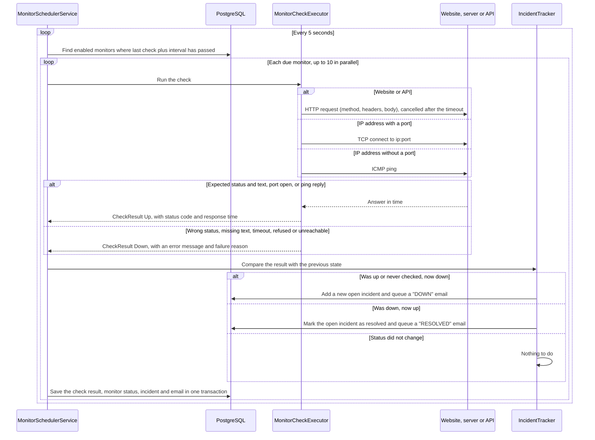
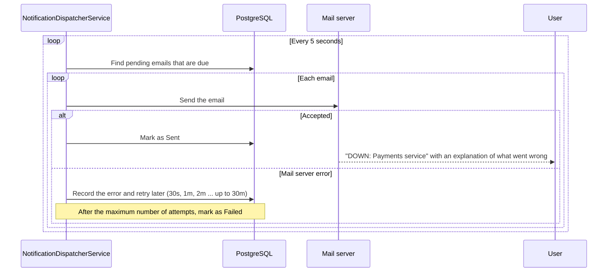
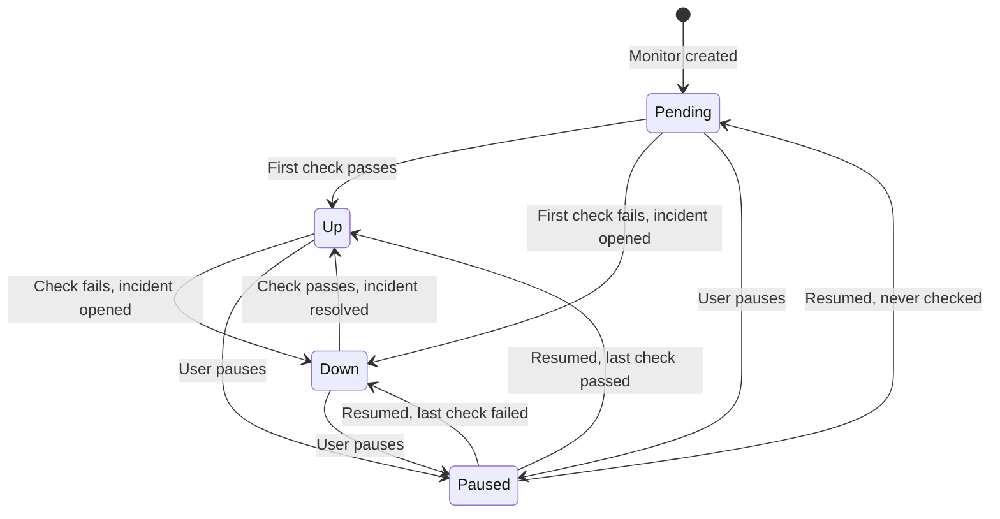

# WatchTower workflow

WatchTower is a simple uptime monitoring platform. Users add websites or API endpoints, and the system checks whether they are online. Everything runs in one ASP.NET Core process: the REST API, the web dashboard, and the background checker. Data lives in PostgreSQL.

## 1. The whole system

The user works in the dashboard, which calls the REST API. Separately, a background service keeps checking every monitor on its own schedule and records the results. The dashboard picks up new results by polling every 10 seconds.

## 2. Registering, logging in, and calling protected endpoints

Passwords are hashed before they are saved; the plain password is never stored. After login, every request to a protected endpoint carries the JWT, and the API only returns rows owned by the user in that token.

## 3. Adding a monitor

The Add monitor page has a sidebar with three monitor types. Picking one swaps the form in the middle to the inputs that type needs:

| Type | Inputs | What counts as "online" |
|------|--------|-------------------------|
| Website URL | URL, expected HTTP status | A GET request returns the expected status |
| IP address | IP, then either Ping or a TCP port | The host answers a ping, or the port accepts a TCP connection |
| API endpoint | Method, URL, headers, body, expected status, optional "response must contain" text | The response has the expected status and, if set, contains the text |

Every type also has a name, a check interval and a timeout. The API rejects bad settings before anything is saved.

The validation rules are:

- URLs must be absolute `http` or `https` URLs (`https` only, outside development).
- URLs and IP addresses must not point at `localhost` or a private, loopback or link-local address.
- The interval must be between 30 seconds and 24 hours.
- The timeout must be greater than zero and shorter than the interval.
- The expected status code must be between 100 and 599.
- TCP ports must be between 1 and 65535.
- API monitors: GET and HEAD requests can't have a body, HEAD can't check response text, and headers like `Host` or `Content-Length` are not allowed.

## 4. One background check cycle

The scheduler wakes every 5 seconds, finds monitors whose next check is due, and runs up to 10 checks at a time. Each result is compared with the monitor's previous state to decide whether an incident starts or ends.

## 4b. Sending the alert emails

Emails are queued in the database (an "outbox") and sent by a separate background worker, so a slow or broken mail server never holds up the checks and no email is lost if the app restarts.

The explanation comes from the check's failure reason. For example, a timeout says the server didn't respond in time, a 503 says the service is unavailable (often maintenance or overload), a DNS failure says the domain couldn't be resolved, and a closed TCP port says nothing accepted the connection.

## 5. Monitor status as the user sees it

The dashboard shows one of four statuses for each monitor. Incidents open and close on the transitions between Up and Down.

## Where each step lives in the code

| Step | Code |
|------|------|
| Web UI: Dashboard, Add monitor, Incidents | `WatchTower.Api/wwwroot/` (`js/dashboard.js`, `js/monitor-form.js`, `js/incidents.js`) |
| Incident report and filters | `IncidentsController`, `IncidentService` |
| Register and login | `AuthController`, `AuthService`, `JwtTokenService` |
| JWT validation and JSON 401 | `Program.cs` |
| Monitor CRUD and ownership checks | `MonitorsController`, `MonitorService` |
| Settings validation | `MonitorValidator`, `UrlSafetyValidator` |
| Background scheduling | `MonitorSchedulerService` |
| HTTP, ping and TCP checks | `MonitorCheckExecutor` |
| Incident rules | `IncidentTracker` |
| Alert email text and explanations | `IncidentEmailComposer`, `IncidentExplainer` |
| Queuing and sending alert emails | `IncidentNotifier`, `NotificationDispatcherService`, `EmailNotificationProcessor`, `SmtpEmailSender` |
| Error responses | `ExceptionHandlingMiddleware` |
| Database tables and relationships | `AppDbContext` |
